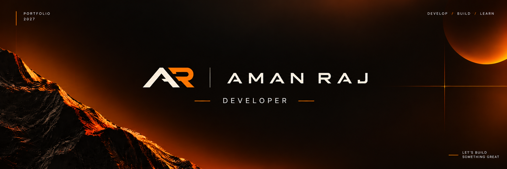

<!-- Save this as README.md in a public repo named exactly: Yash7256/Yash7256 -->
<!-- Put banner.svg in assets/banner.svg (animated, 1584 x 396). Swap for your own banner.png if you prefer -->

<div align="center">



<br/>

```
AMAN RAJ
Developer  |  Founder, Anvik Labs  |  OCI Certified (x3)
```


<br/>

[](https://linkedin.com/in/YOUR_LINKEDIN)
[](https://instagram.com/YOUR_INSTAGRAM)
[](https://x.com/YOUR_TWITTER)
[](https://YOUR_ANVIK_LABS_SITE)
[](mailto:YOUR_EMAIL)

</div>

<br/>

---

## `00 / ABOUT`

I am Aman Raj, a fourth year B.Tech student (batch of 2023 to 2027), graduating June 2027. I build software that solves problems I see around me, starting with problems I have felt myself.

I founded **Anvik Labs**, a technology studio with two tracks: our own products, and design and development work for clients. Anvik Labs is built together with Harshita Upadhyay, a UI/UX product designer. I handle development, she designs the interfaces people actually use.

I learned web development and DevOps through Harkirat Singh's 100xDevs Cohort 3.0 and hold three Oracle Cloud Infrastructure professional certifications.

<br/>

## `01 / ANVIK LABS`

```
STUDIO      Anvik Labs
TYPE        Technology studio
TAGLINE     Curious by Design. Precise by Engineering.
TRACKS      01  Own products
            02  Client work: UI/UX design, web development, AI and chatbots
FOUNDERS    Aman Raj (development)  |  Harshita Upadhyay (UI/UX design)
```

Anvik Labs takes its name from the Sanskrit *Anviksha*, meaning inquiry. The studio works on one idea: question, explore, understand, build.

| Product | Description | Status |
| :-- | :-- | :-- |
| **CyberSec Toolkit** | Web platform for network security scanning with AI explained results | Live on GitHub |
| **Notify-ED** | Marks publishing and student notification system for faculty | Live |
| **Designers Room** | First product from Anvik Labs | Launching 8 November 2026 |

Clients we work with: startups, small businesses and individuals who need a website or app designed, redesigned or built.

<br/>

## `02 / PROJECTS`

### CyberSec Toolkit

An async network security platform. Point it at a target and it scans ports, fingerprints services, pulls live CVE data, detects technologies, maps MITRE ATT&CK techniques and runs AI analysis, streamed live over SSE.

- Pure asyncio scanner with no nmap dependency, 8 scan modes (TCP connect, SYN, UDP, FIN, NULL, XMAS, ACK, zombie), adaptive concurrency and a token bucket rate limiter
- Network tools: DNS, WHOIS, ping, traceroute, SSL/TLS audit, HTTP headers, subdomain enumeration, GeoIP, OS fingerprinting, web app scanner
- AI layer using Groq with Gemini fallback and a rule based fallback when no keys are present
- React dashboard, CLI, REST API and Prometheus metrics
- Security by design: private IP ranges blocked, DNS rebinding protection, JWT on all scan endpoints, rate limited API

`FastAPI` `PostgreSQL` `Alembic` `Redis` `Docker` `React` `Tailwind` `Python`

[Repository](https://github.com/Yash7256/cybersec-toolkit)

<br/>

### Notify-ED

A system for faculty and academic admins to publish marks quickly. A professor uploads an Excel roster and enters marks, and students are notified by email, WhatsApp and an in app feed.

- Roster parsing with duplicate safe upserts and validated marks entry
- Delivery logging with retry for failed notifications
- Email over SMTP or webhook, WhatsApp through WATI or webhook
- Row level security on all database tables

`React 19` `Vite` `TypeScript` `Tailwind` `shadcn/ui` `Express` `Supabase` `Vercel`

[Live](https://notifyed.vercel.app) | [Repository](https://github.com/Yash7256/Notify-ED)

<br/>

### Designers Room

First product from Anvik Labs, launching 8 November 2026.

[Anvik Labs](https://YOUR_ANVIK_LABS_SITE)

<br/>

## `03 / STACK`

```
LANGUAGES     JavaScript  TypeScript  Python
FRONTEND      React  Vite  Tailwind CSS  shadcn/ui  Recoil
BACKEND       Node.js  Express  FastAPI
DATABASES     PostgreSQL  MongoDB  Redis  Supabase
DEVOPS        Docker  Git  GitHub  CI/CD  Oracle Cloud Infrastructure
AI            LLM APIs (Groq, Gemini)  AI assisted analysis pipelines
SECURITY      Network scanning  CVE and MITRE ATT&CK mapping  JWT auth
```

<div align="center">


</div>

<br/>

## `04 / CERTIFICATIONS`

| Certification | Issuer |
| :-- | :-- |
| Oracle Cloud Infrastructure Generative AI Professional | Oracle |
| Oracle Cloud Infrastructure Developer Professional | Oracle |
| Oracle Cloud Infrastructure DevOps Professional | Oracle |

<br/>

## `05 / EDUCATION`

```
B.TECH        Fourth year, seventh semester, batch of 2023 to 2027
COHORT        100xDevs Cohort 3.0 by Harkirat Singh (Web Development and DevOps)
COVERED       HTML, CSS, JavaScript, async JS, DOM, Node.js, Express, middlewares,
              JWT auth, Zod, MongoDB, bcrypt, React, React Router, Context API,
              Recoil, custom hooks, Tailwind CSS, TypeScript
```

<br/>

## `06 / GITHUB STATS`

<div align="center">


</div>

<br/>

## `07 / OPEN TO`

```
01  Freelance and client projects: UI/UX design, web apps, AI and chatbot development
02  Internships and full time roles from 2027
03  Collaboration on security tooling, developer tools and product engineering
```

<br/>

## `08 / CONTACT`

```
LINKEDIN      linkedin.com/in/YOUR_LINKEDIN
INSTAGRAM     instagram.com/YOUR_INSTAGRAM
X / TWITTER   x.com/YOUR_TWITTER
ANVIK LABS    YOUR_ANVIK_LABS_SITE
EMAIL         YOUR_EMAIL
GITHUB        github.com/Yash7256
```

<br/>

<div align="center">

```
CURIOUS BY DESIGN. PRECISE BY ENGINEERING.
```

</div>
